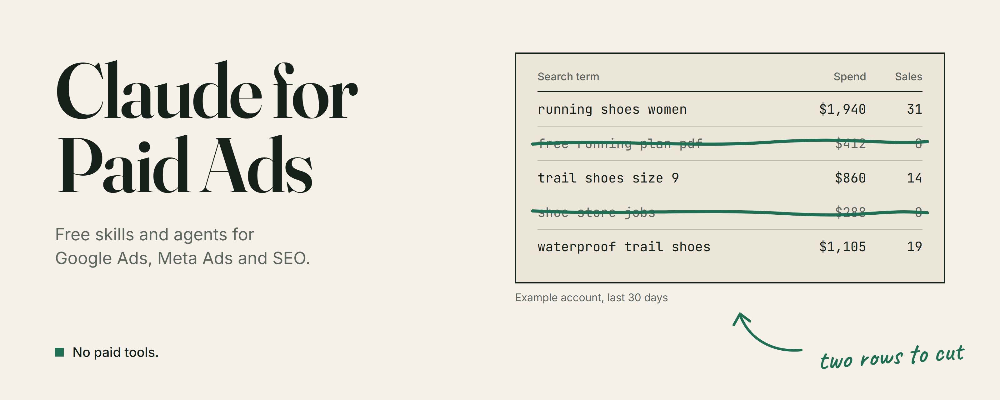
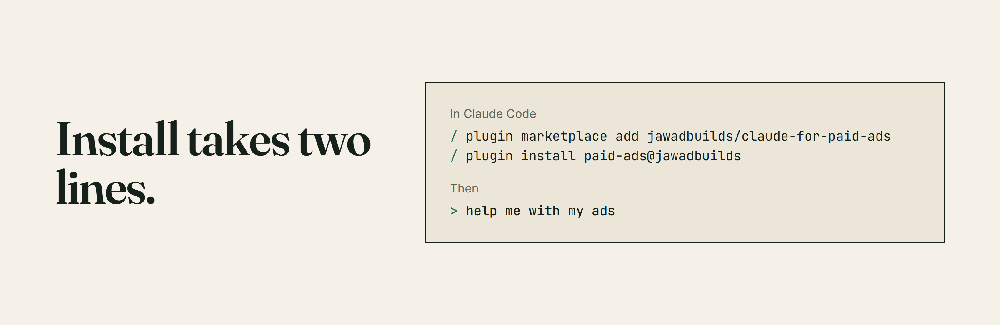
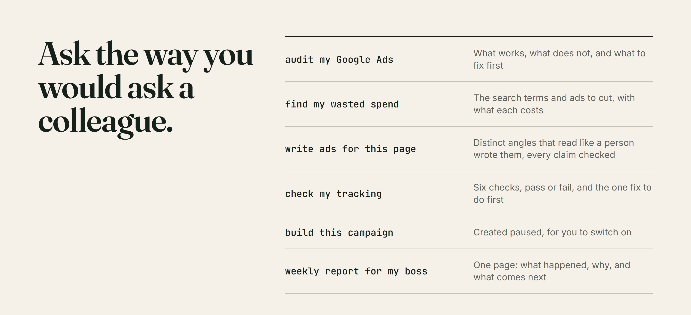
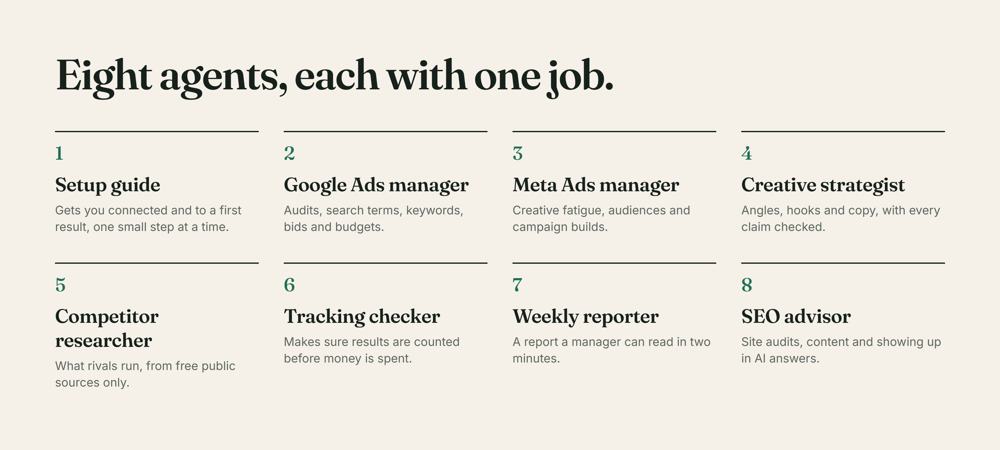
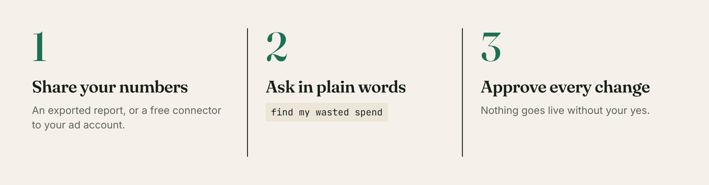
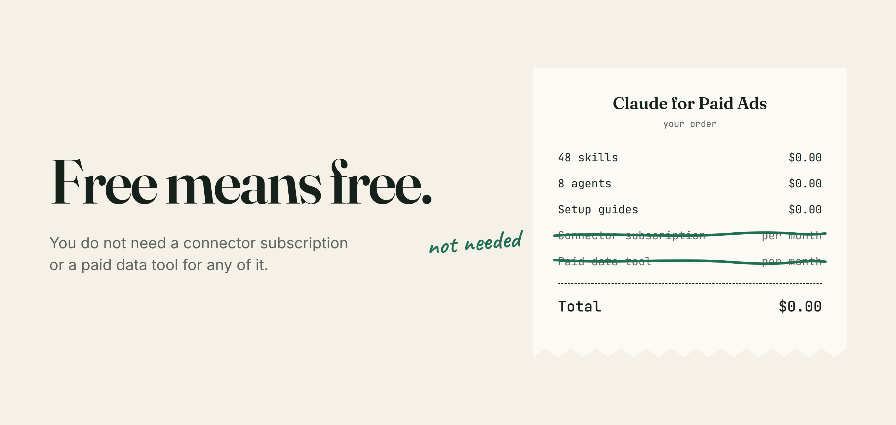
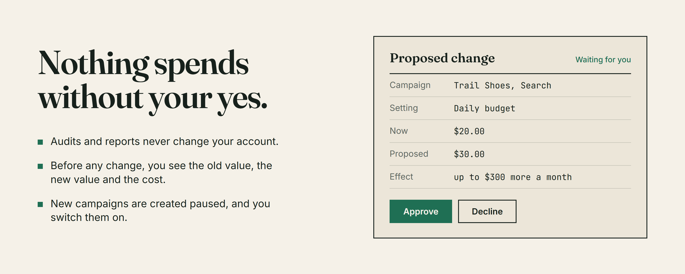
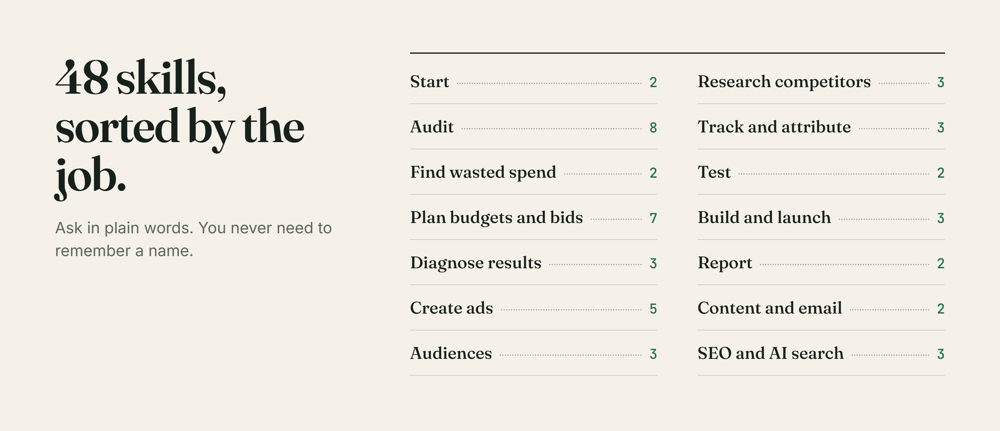
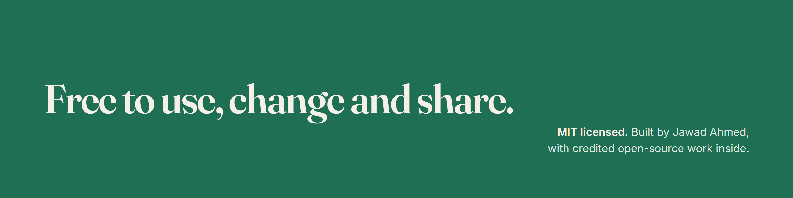

<p align="center">
  <picture>
    <source media="(prefers-color-scheme: dark)" srcset="assets/banner-dark.png">
    
  </picture>
</p>

<h1 align="center">Claude for Paid Ads</h1>

<p align="center">
  <strong>Free skills and agents for performance marketers.</strong><br>
  Google Ads, Meta Ads and SEO in one install, with no paid tools.
</p>

<p align="center">
  <a href="#quickstart">Quickstart</a> ·
  <a href="#what-you-can-do">What it does</a> ·
  <a href="#meet-the-team">The team</a> ·
  <a href="#free-means-free">Free</a> ·
  <a href="#built-to-be-safe-with-your-money">Safety</a> ·
  <a href="#install">Install</a> ·
  <a href="#questions">Questions</a>
</p>

<p align="center">
  <a href="LICENSE"></a>
  
  
  
  
</p>

Claude for Paid Ads is a free add-on for Claude Code. It teaches Claude the everyday work of running ads: auditing an account, finding wasted spend, writing and checking ad copy, confirming that tracking works, building a campaign and writing the weekly report.

It is written for new marketers, freelancers and small teams. You ask in plain words, and you do not need to be technical.

Two words you will see a lot. A **skill** is a set of instructions Claude follows for one job. An **agent** is a specialist that uses several skills.

> An independent community project. Not affiliated with or endorsed by Anthropic, Meta or Google.

## Quickstart

<p align="center">
  <picture>
    <source media="(prefers-color-scheme: dark)" srcset="assets/install-dark.png">
    
  </picture>
</p>

Open [Claude Code](https://claude.com/claude-code), which needs a paid Claude plan, and paste these, one at a time:

```text
/plugin marketplace add jawadbuilds/claude-for-paid-ads
/plugin install paid-ads@jawadbuilds
```

Restart Claude Code, then say:

```text
help me with my ads
```

Claude asks three short questions and takes you to the right place. New to all this? Read [Zero to ROAS, the beginner guide](docs/start-here.md).

## What you can do

<p align="center">
  <picture>
    <source media="(prefers-color-scheme: dark)" srcset="assets/what-you-can-do-dark.png">
    
  </picture>
</p>

Once it is installed you never need a command. Say what you want in plain words.

<details>
<summary><strong>All ten everyday jobs</strong></summary>

| You want to | Say | You get |
|---|---|---|
| Know what is wrong | `audit my Google Ads` | What is working, what is not, and what to fix first |
| Stop wasting money | `find my wasted spend` | Search terms, placements and ads to cut, with the amount each costs |
| Know what you can afford | `what should my cost per lead be` | Targets worked back from the most you can pay for a customer |
| Make new ads | `write ads for this page` | Distinct angles, copy within each platform's limits, every claim checked |
| Fix copy that reads like AI | `remove the AI slop from this ad` | A before and after for each line, with the reason |
| See what rivals run | `what are my competitors running` | Their longest-running ads and the patterns behind them |
| Trust your numbers | `check my tracking` | Six checks, each pass or fail, and the one fix to do first |
| Launch safely | `build this campaign` | On Meta, a campaign created paused for you to switch on. On Google, a build sheet you enter yourself, because Google's connector cannot create campaigns |
| Report upward | `weekly report for my boss` | One page: what happened, why, and what happens next |
| Grow free traffic | `audit my site for SEO` | The biggest problems in order, with the effort each takes |

</details>

## Meet the team

<p align="center">
  <picture>
    <source media="(prefers-color-scheme: dark)" srcset="assets/team-dark.png">
    
  </picture>
</p>

Eight agents, each with one job. You do not call them by name. Claude picks the right one from what you ask.

<details>
<summary><strong>What each agent does</strong></summary>

| Agent | What it does |
|---|---|
| **Setup guide** | Gets you connected and to your first result, one small step at a time |
| **Google Ads manager** | Audits, search terms, keywords, bids, budgets and new Search campaigns |
| **Meta Ads manager** | Audits, creative fatigue, audiences, budgets and campaign builds on Facebook and Instagram |
| **Creative strategist** | Angles, hooks, headlines and briefs, with every claim checked before use |
| **Competitor researcher** | What rivals are advertising, from free public sources only |
| **Tracking checker** | Makes sure conversions are counted correctly before money is spent |
| **Weekly reporter** | Turns account numbers into a report a manager reads in two minutes |
| **SEO advisor** | Site audits, content, keywords and showing up in AI answers |

</details>

## How it works

<p align="center">
  <picture>
    <source media="(prefers-color-scheme: dark)" srcset="assets/how-it-works-dark.png">
    
  </picture>
</p>

## Free means free

<p align="center">
  <picture>
    <source media="(prefers-color-scheme: dark)" srcset="assets/free-dark.png">
    
  </picture>
</p>

This kit has nothing to sell.

No skill needs a paid key. Each one works from a free connector, an exported report or numbers you paste in. Some need one more export than the basic ones, and Claude tells you which. Nothing paid is installed with the core kit. It contains no affiliate or tracking links, and a script in the repository checks for them.

Three free ways to give Claude your numbers:

| Route | Time | Guide |
|---|---|---|
| Export a report from your ad account | 2 minutes | [Use exports](docs/use-exports.md) |
| Meta's own connector | 5 minutes in the Claude app | [Connect Meta](docs/connect-meta.md) |
| Google's own open-source connector | An hour or more | [Connect Google](docs/connect-google.md) |

## Built to be safe with your money

<p align="center">
  <picture>
    <source media="(prefers-color-scheme: dark)" srcset="assets/safety-dark.png">
    
  </picture>
</p>

Every agent follows the same rules. Audits and reports never change your account. Before any change you see the old value, the new value and what it does to spend. New campaigns are created paused. More in [Safety](docs/safety.md).

## What is inside

<p align="center">
  <picture>
    <source media="(prefers-color-scheme: dark)" srcset="assets/contents-dark.png">
    
  </picture>
</p>

[Browse all 48 skills by job](docs/skills.md).

| | |
|---|---|
| [`skills/`](skills) | The 48 skills |
| [`agents/`](agents) | The 8 agents |
| [`docs/`](docs) | The beginner guide, three connection guides and the safety page |
| [`plugins/`](plugins) | Three optional plugins, described under Install |
| [`scripts/check.py`](scripts/check.py) | The check that keeps the kit well-formed and free-only |

## Install

### The core kit

```text
/plugin marketplace add jawadbuilds/claude-for-paid-ads
/plugin install paid-ads@jawadbuilds
```

### Three optional plugins

The same marketplace carries full copies of three open-source plugins by [Agrici Daniel](https://github.com/AgriciDaniel). The core kit's agents use them when they are installed.

| Plugin | Adds | Install |
|---|---|---|
| `claude-ads` | Evidence-scored audits across 12 ad platforms | `/plugin install claude-ads@jawadbuilds` |
| `claude-seo` | Full SEO analysis: technical, content, schema, local and AI search | `/plugin install claude-seo@jawadbuilds` |
| `claude-blog` | Researched, sourced and reviewed blog posts for Google and AI answers | `/plugin install claude-blog@jawadbuilds` |

Some of their features are optional and use services with their own keys or charges. Nothing in the core kit needs them.

<details>
<summary><strong>Everything in one command</strong></summary>

Clone the repository, then run the installer from its folder.

```text
git clone https://github.com/jawadbuilds/claude-for-paid-ads
cd claude-for-paid-ads
```

Windows:

```powershell
.\install.ps1
```

If Windows refuses to run the script, use `powershell -ExecutionPolicy Bypass -File .\install.ps1` instead.

macOS and Linux:

```bash
./install.sh
```

</details>

<details>
<summary><strong>Uninstall</strong></summary>

```text
/plugin uninstall paid-ads@jawadbuilds
```

Repeat for any optional plugin you installed.

</details>

## Questions

<details>
<summary><strong>Is it really free?</strong></summary>

The kit is free, MIT licensed, and needs no paid ad tool. Claude Code itself needs a paid Claude plan (Pro or higher) or paid API use, and your ad platforms charge for the ads you run.

</details>

<details>
<summary><strong>Do I have to connect my ad account?</strong></summary>

No. Export a report and share the file. That works for every skill, and Claude cannot change anything that way.

</details>

<details>
<summary><strong>Will it change my ads?</strong></summary>

Only if you ask it to, and only after you approve the exact change. New campaigns are created paused.

</details>

<details>
<summary><strong>I am new to ads. Is this for me?</strong></summary>

Yes. Say "I'm new, explain that simply" at any point and Claude switches to small steps and plain words. Start with the [beginner guide](docs/start-here.md).

</details>

<details>
<summary><strong>Which Claude does it work with?</strong></summary>

It is built as a Claude Code plugin. The skills are plain Markdown files, so other tools that support skills can read them too.

</details>

<details>
<summary><strong>Does it cover TikTok, LinkedIn or Amazon?</strong></summary>

The core kit is built around Google and Meta, with an audit for LinkedIn. The optional `claude-ads` plugin covers 12 platforms.

</details>

<details>
<summary><strong>Is this an official Anthropic product?</strong></summary>

No. It is an independent community project.

</details>

## Credits

Built and maintained by [Jawad Ahmed](https://github.com/jawadbuilds).

This kit stands on open-source work by [Agrici Daniel](https://github.com/AgriciDaniel), [Corey Haines](https://github.com/coreyhaines31) and Ryze AI. [CREDITS.md](CREDITS.md) lists exactly what came from where and what was changed.

Found a problem or have a skill to add? See [CONTRIBUTING.md](CONTRIBUTING.md).

<p align="center">
  
</p>

## License

[MIT](LICENSE). Work from other authors keeps its own licence, listed in [CREDITS.md](CREDITS.md).
